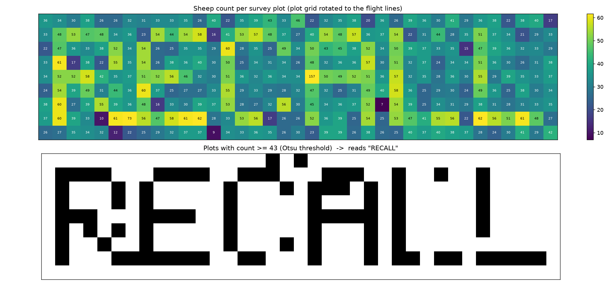

# MONGOLIA: The Baa-rilliant task! (Sigmoid, CV, Medium)

**Decoded word: RECALL** (the flag is this word in the competition format; not written out here).



## 1. What the census looks like

`survey_plots.csv` gives the position of each of the 333 photos. The positions form a
regular grid of **9 rows x 37 columns** (9 x 37 = 333), spaced about 50 m apart and
rotated **27 degrees**, which is the direction of the flight lines. Rotating by -27 degrees
and rounding to the grid spacing puts every plot in exactly one cell: each column holds
9 plots and each row holds 37, and no plot sits more than 0.26 of a spacing from its
cell centre.

So the census is a 9 x 37 picture. That is exactly six 5x7 dot-matrix letters, each 5
wide with a 1-plot gap, plus a 1-plot margin on every side (1 + 6x6 = 37, 1 + 7 + 1 = 9).

## 2. Counting the sheep (`counter.py`)

* Model: density-map regression. The backbone is an ImageNet-pretrained ConvNeXt-Tiny
  (timm). A small FPN head fuses the stride-8, 16 and 32 features and outputs a
  non-negative density at stride 8. The count is the sum of the density.
* Targets: each dot in `train_points.csv` becomes a Gaussian (sigma 4 px), summed per
  8x8 cell and multiplied by 100. Loss: MSE on the density plus a small L1 term on the
  count.
* Augmentation: random rescale (0.75 to 1.25), 384 px crops, flips and 90-degree
  rotations, and brightness, contrast and saturation jitter. Training: AdamW with a
  one-cycle schedule, 40 epochs per fold, batch 2, fp16 on an RTX 3070 Ti.
* Validation: 5-fold cross-validation on the 280 annotated photos. Each model is
  scored only on its own held-out fold, with 8x dihedral test-time augmentation (TTA).

| held-out (out-of-fold) error on train | value |
|---|---|
| MAE, all 280 photos | **2.25 sheep** (train counts: mean 41.5, max 119) |
| MAE, excluding the label error below | **1.93 sheep** |
| median absolute error | 1.2 sheep |
| per fold | 2.26 / 1.58 / 2.21 / 2.08 / 3.13 |

Label error: `train_107.jpg` is annotated with **0** sheep, but the photo clearly shows
about 90 (the model predicts 93). It is the only large error, and it is a ground-truth
mistake, not a model mistake.

Survey counts: the mean of the 5 fold models x 8 TTA views, rounded. They are in
`counts.csv` (333 rows, `image,count`).

## 3. Decoding (`decode.py`)

The survey counts have two groups of values. "Background" plots average 32 sheep
(sd 7). "Ink" plots average 53 (sd 13). Otsu's threshold on all 333 counts is **43**.
Thresholding the 9 x 37 grid at 43 gives:

```
................#.#..................
.####...####..###...###..#..#..#.....
.#...#.#.....#...#.###.#.#.....#.....
.#...#.#.....#.....#...#.#.....#.....
.###...####..#.....#####.#.....#.....
.#.#.#.#.....#.....#...#.#.....#.....
.#..#..#.....#...#.#...#.#...........
.#...#######..##...#...#.##.##.#####.
.....................................
```

Each 5x7 cell is matched against a standard 5x7 dot-matrix font (A to Z, `font5x7.py`)
by Hamming distance:

| cell | best | dots differing (of 35) | runner-up | dots differing |
|---|---|---|---|---|
| 1 | **R** | 2 | P | 5 |
| 2 | **E** | 1 | F | 5 |
| 3 | **C** | 1 | O | 4 |
| 4 | **A** | 2 | H | 7 |
| 5 | **L** | 2 | E | 7 |
| 6 | **L** | 1 | E | 8 |

The word is **RECALL**, a fitting word for an ML competition (precision/recall).

Only 11 of the 333 plots fall on the wrong side of the threshold compared with a
perfect "RECALL" bitmap. Five of them are within 3 sheep of the threshold. Viewing the
photos explains the larger misses:

* `survey_0153` is a barn doorway packed with sheep. The model undercounts it (24).
* `survey_0232` is a gap cell, but the photo really does show about 70 sheep.
* `survey_0112` is an "ink" cell, but the photo really shows only about 17 sheep.

So the hidden picture has a little noise of its own, and the font match tolerates it.

## 4. How robust is the word to counting errors? (`robustness.py`)

The test is a Monte Carlo. Each trial perturbs all 333 survey counts, re-runs Otsu,
re-thresholds and re-reads the word. There are two kinds of perturbation: (a) relative
errors resampled from the out-of-fold errors, and (b) Gaussian noise with sd equal to
1.25 x MAE. Each kind is scaled x1, x2, x3 and x5. The noise is added on top of counts
that already contain the model's own error, so the test is conservative.

| error scale | resampled OOF errors | Gaussian |
|---|---|---|
| x1 (the measured held-out error) | **98.4 %** RECALL | **99.9 %** RECALL |
| x2 | 80.3 % | 91.0 % |
| x3 | 50.5 % | 60.1 % |
| x5 | 12.0 % | 9.7 % |

When decoding fails, it is almost always the first letter that changes: AECALL,
PECALL, RECPLL, RBCALL, REBALL and so on. None of these is a word. "CALL" survives even
at 5x noise. **No alternative English reading exists.** The only near-miss letters are
R to P (3 extra dots) and C to O (3 extra dots), and "PECALL" and "REOALL" are not words.

## Reproduce

```
python -I solve.py            # counts.csv, figure.png, word, robustness table
python -I counter.py --epochs 40   # (re)train the 5 fold models on a CUDA GPU
```

`solve.py` trains the fold models if `runs/fold*.pt` is missing. Otherwise it
reuses them, or the cached per-fold survey predictions `runs/survey_fold*.csv`. It
then writes `counts.csv`, prints the held-out MAE and the decoded bitmap and word,
saves `figure.png`, and runs the robustness test. The weights (5 x 113 MB) are not in
the repository. The per-fold out-of-fold and survey predictions are.

Files: `solve.py`, `counter.py`, `decode.py`, `font5x7.py`, `robustness.py`,
`counts.csv`, `figure.png`, `runs/oof_fold*.csv`, `runs/survey_fold*.csv`,
`runs/survey_pred_mean.csv`.
